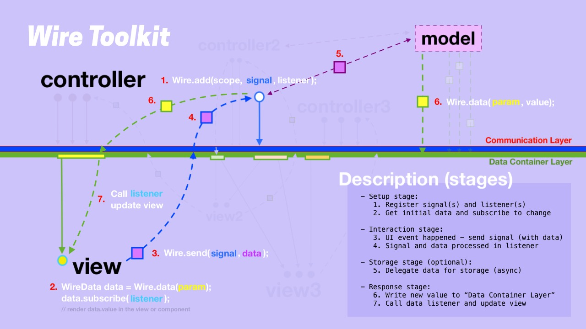
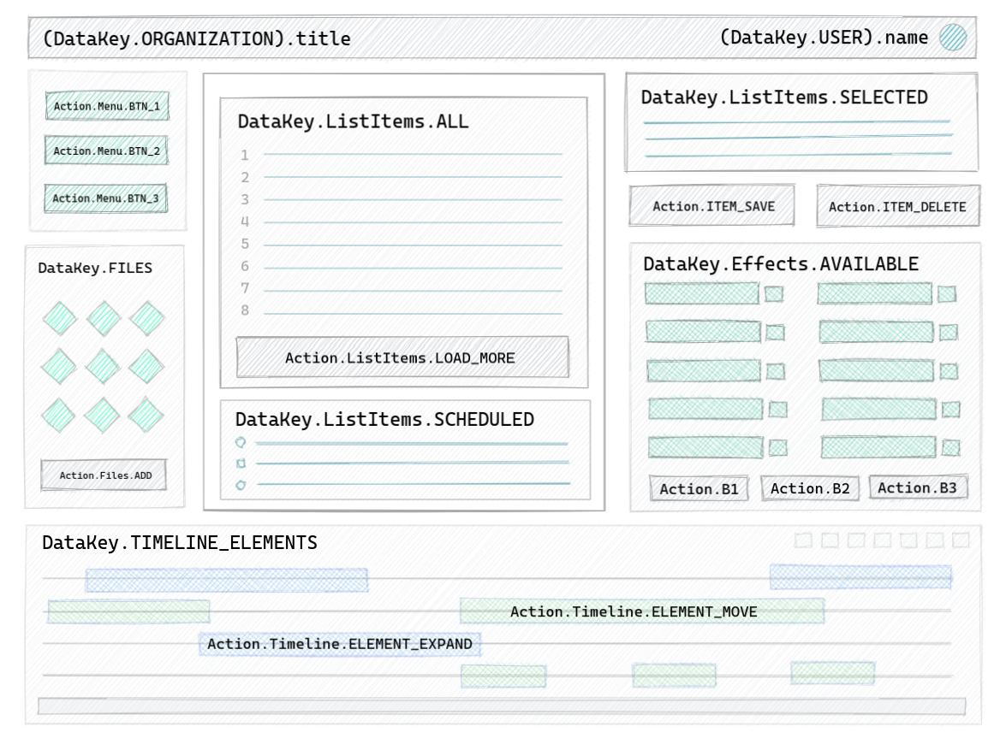
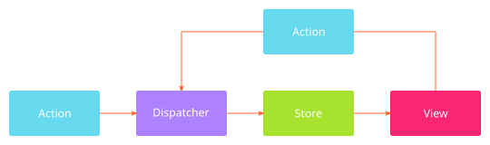
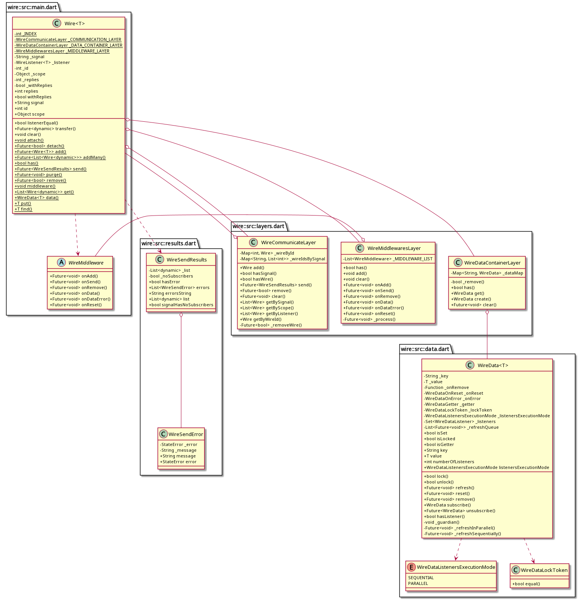
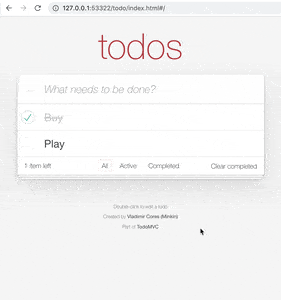
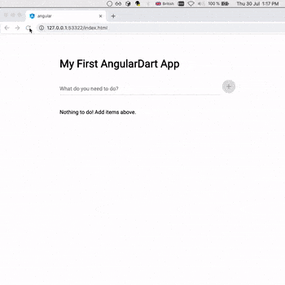

# Wire: communication and data-container layers

Wire implements the ["Strings API"](https://medium.com/@vladimir.cores/introduction-of-strings-api-741f080ec63d) idea: a system's components — logical or visual — are described with sets of string keys instead of direct references. It provides two layers built from string keys: one binds keys to handlers (**communication**), the other binds keys to data observers (**data container**). One set of keys describes the data a component consumes (its **Data API**); another describes the signals it produces or reacts to (its **Signals API**).

## Contents

- [A library aimed at decoupling UI from business logic](#a-library-aimed-at-decoupling-ui-from-business-logic)
- [Diagram steps and terminology](#diagram-steps-and-terminology)
- [Usage](#usage)
- [A few words on architecture](#a-few-words-on-architecture)
- [Using the Command Pattern](#using-the-command-pattern)
- [Utilities](#utilities)
- [Some history of the Strings API idea](#some-history-of-the-strings-api-idea)
- [General concepts of MVC](#general-concepts-of-mvc)
- [A few words about Flux](#a-few-words-about-flux)
- [Wire in Flutter / `WireDataBuilder<T>`](#wire-in-flutter--wiredatabuildert)
- [Wire API](#wire-api)
- [API behavior and caveats](#api-behavior-and-caveats)
- [Examples](#examples)
- [License](#license)

## A library aimed at decoupling UI from business logic



## Diagram steps and terminology

The examples below follow the numbered steps shown in the diagram above:

| Step | What happens |
| --- | --- |
| 1 | A controller registers a handler for a signal in a scope — `Wire.add`. |
| 2 | A view subscribes to a data key so it can react to updates — `Wire.data(key).subscribe(...)`. |
| 3 | A view (or an external source such as network traffic) turns an interaction into a signal — `Wire.send`. |
| 4 | The controller's handler processes the signal asynchronously. |
| 5 | A model or middleware processes and persists the data. |
| 6 | The new value is written to the data-container layer — `Wire.data(key, value: ...)`. |
| 7 | Subscribers are notified and the view re-renders itself. |

Terms used throughout this document:

- **Signal** — a string key used for system-wide communication (Communication Layer).
- **Wire** — a handler bound to a signal and a scope; also the name of the library and its static API.
- **Scope** — the object that owns a handler, used to group and later remove related wires.
- **Data API** — the set of string keys a component consumes as data.
- **Signals API** — the set of string keys a component produces or reacts to.
- **`WireData`** — an observable container holding the value for one data key (Data Container Layer).
- **Middleware** — an observer of add/send/remove/data events, typically used for persistence or logging.

"Box" in the examples means a logical component: a controller, model, view, or middleware.

Wire has two layers:

- **Communication layer** — "signals" (string keys) with associated handlers bound to a specific scope. Each `Wire` instance holds a scope, and many wires can share the same scope. Its main methods are `Wire.add` and `Wire.send`.
- **Data-container layer** — an in-memory key-value map in which each value is an instance of `WireData`: an observable container holding a dynamic value that can be subscribed to for updates. Its main method is `Wire.data`.

`WireData` also has a dedicated Flutter implementation — the [**`WireDataBuilder` widget**](https://pub.dev/packages/wire_flutter). It lets you reuse business logic across web and mobile projects built with Flutter. See the `example` folder in both this repository and [wire_flutter](https://github.com/WiresWare/wire_flutter/tree/master/example): the `_shared` folder contains reusable code imported into both projects as a Dart package (via a custom package path), shared as a separate Git branch using [git-subrepo](https://github.com/ingydotnet/git-subrepo).

[](https://www.youtube.com/watch?v=6e3OUaigjcw)

Wire has also been ported to:

- [Wire Haxe](https://github.com/WiresWare/wire_haxe), which can compile — or, more precisely, transpile — reusable code to any of the following languages: **JavaScript, Java, C#, C++, HL (HashLink), Lua, PHP**.
- [Wire TS](https://github.com/WiresWare/wire_ts), with a todo-commands example.

The snippets use symbols defined in the `example/` projects rather than in the library: `CounterDataKeys`/`CounterSignalsKeys`, `DomElement`, `DivElement`, `ButtonElement`, `SpanElement`, `DomElement.dom`, `ViewSignals`, `DataKeys`, `InputDTO`/`EditDTO`/`FilterValues`, `CountCompletedGetter`, `TodoModel`, `TodoVO`, the `Todo*Command` classes, `ApplicationView`, and `ArchSampleKeys`. Look them up under `example/counter/lib/mvc`, `example/todo-commands/lib/src`, and `example/_shared/lib/todo`; `WireDataWidgetBuilder` is part of `wire_flutter`.

## Usage

The steps below refer to the diagram and legend above. This is an example of a counter web application (see the `./example/counter` folder).

#### Steps 1, 4, 6 — a "box" that processes signals

First, add wires and `WireListener`s to the system. In response, the controller immediately sets a new value in the data-container layer from a function that makes the decision: `Wire.data(CounterDataKeys.COUNT, value: (oldValue) => (oldValue as int? ?? 0) + 1)`.

```dart
class CounterController {
  CounterController() {
    // 1. scope, string key, handler function
    Wire.add(this, CounterSignalsKeys.INCREASE, (dynamic payload, wireId) async {
      // 4. the handler processes the signal asynchronously
      // the new value can be a function or a plain value
      Wire.data(CounterDataKeys.COUNT, value: (value) {
        final count = value as int?;
        // 6. Update data
        return (count ?? 0) + 1;
      });
    });
    // The handler for CounterSignalsKeys.DECREASE is in example/counter/lib/mvc/controller/counter_controller.dart
  }
}
```

Since the counter example has no Model "box," the controller updates the data itself in steps 4 and 6.

#### Steps 2, 7 — the view subscribes to data changes and knows how to update itself

```dart
class CounterDisplay extends DomElement {
  CounterDisplay() : super(DivElement()) {
    dom.className = 'spectrum-Body spectrum-Body--L';

    final wireData = Wire.data(CounterDataKeys.COUNT);
    wireData.subscribe(update);
    update(wireData.value ?? 0); // the view can define a default value
  }

  Future<void> update(value) async {
    print('> CounterDisplay -> update: ${value}');
    dom.text = value.toString();
  }
}
```

#### Step 3 — another view translates a UI event into a signal

```dart
class CounterButton extends DomElement {
  CounterButton(String title, String signal) : super(ButtonElement()) {
    // DOM initialization and styling
    final span = SpanElement()
      ..text = title
      ..title = title
      ..className = 'spectrum-Button-label';
    dom // dom is a component from super constructor
      ..className = 'spectrum-Button spectrum-Button--primary'
      ..onClick.listen((event) => Wire.send(signal)) // catch a user interaction and produce a signal
      ..append(span);
  }
}
```

#### Steps 4, 5 — a "middleman" that catches everything happening in the system (in this example, it stores the counter value in `localStorage`)

```dart
import 'dart:js_interop_unsafe';

import 'package:web/web.dart';

class CounterStorageMiddleware extends WireMiddleware {
  final storage = window.localStorage;

  int getInitialValue() {
    return storage.has(CounterDataKeys.COUNT)
      ? int.parse(storage.getItem(CounterDataKeys.COUNT)!)
      : 0;
  }

  @override
  Future<void> onData(String key, prevValue, nextValue) async {
    print('> CounterMiddleware -> onData: key = ${key} | ${prevValue}-${nextValue}');
    if (key == CounterDataKeys.COUNT) {
      if (nextValue != null) storage.setItem(key, nextValue.toString());
      else if (storage.has(key)) storage.removeItem(key);
    }
  }

  @override
  Future<void> onAdd(Wire<dynamic> wire) async {}

  @override
  Future<void> onRemove(String signal, [Object? scope, WireListener<dynamic>? listener]) async {}

  @override
  Future<void> onSend(String signal, [Object? payload, Object? scope]) async {}

  @override
  Future<void> onDataError(dynamic error, String key, dynamic value) async {}

  @override
  Future<void> onReset(String key, dynamic value) async {}
}
```

This middleware can be considered part of the Model. For logging only, the library has `WireViewerMiddleware`, but it is still **in development** and not ready for general use; for persistence, `WireMixinWithDatabase` with a `WireDatabaseServiceAbstract` implementation covers the same pattern (see Utilities below).

### Initialization

```dart
void main() {
  /// COUNTER EXAMPLE ======================================
  final counterStorageMiddleware = CounterStorageMiddleware();
  // Set the initial value from local storage; this could be part of the CounterStorageMiddleware constructor.
  Wire.data(CounterDataKeys.COUNT, value: counterStorageMiddleware.getInitialValue());
  // Register the middleware after setting the initial value to avoid saving it.
  Wire.middleware(counterStorageMiddleware);
  // Instantiate the controller that registers all signal handlers.
  CounterController();
  // Find the root element in index.html and map it to a functional component
  final root = document.querySelector('#root');
  ApplicationView(root as DivElement?);
}
```

## A few words on architecture

The two layers and their key terms are introduced at the top of this document. The design goal behind them is separation of concerns: here is a good saying from Robert C. Martin:
> "Architecture is not about making decisions earlier, but making decisions late. Good architecture is a software structure that allows you to defer critical decisions for as long as possible, defer them to the point where you've got enough information to actually make them, or not make them".

It's always good to separate (protect) your business rules from UI changes and make the user interface **a plug-in** to the business rules (and vice versa). The same applies to domain data: make it a plug-in to both the business rules and the UI.

## Using the Command Pattern

It's good practice to extract data-manipulation logic into reusable, composable classes. The Command Pattern together with Wire is a perfect fit for that. Let's explore an example of a Todo application that uses commands as processing units for signals (see the project in the `example/todo-commands` folder).

### Registering commands

```dart
class TodoController {
  TodoController() {
    Wire.addMany(this, {
      ViewSignals.INPUT:    (input, _) => TodoInputCommand(input as InputDTO).execute(),
      ViewSignals.EDIT:     (input, _) => TodoEditCommand(input as EditDTO).execute(),
      ViewSignals.DELETE:   (input, _) => TodoDeleteCommand(input as String).execute(),
      ViewSignals.TOGGLE:   (input, _) => TodoToggleCommand(input as String).execute(),
      // Utilities
      ViewSignals.FILTER:          (input, _) => ApplyFilterToTodosCommand(input as FilterValues).execute(),
      ViewSignals.CLEAR_COMPLETED: (_, __) => ClearCompletedTodosCommand().execute(),
      ViewSignals.COMPLETE_ALL:    (input, _) => CompleteAllTodosCommand(input as bool).execute()
    });
    // Getter — shrink complex conditions across multiple data sources to a single data key
    Wire.data(DataKeys.GET_COUNT_COMPLETED, getter: CountCompletedGetter().getter);
  }
}
```

Each `...Command` extends `WireCommandWithWireData`, which mixes in `WireMixinWithWireData` for data helpers (`get`, `getMany`, `update`, `reset`, `remove`, `has`, `hasNot`). The `execute()` method is declared by `WireCommandAbstract<T>` and implemented by each command. Command constructors may accept properties, and the business logic is written in `execute`:

```dart
class TodoEditCommand extends WireCommandWithWireData<void> {
  TodoEditCommand(this.editTodoDTO);

  final EditDTO editTodoDTO;

  @override
  Future<void> execute() async {
    final todoText = editTodoDTO.text;
    final todoNote = editTodoDTO.note;
    final todoId = editTodoDTO.id;
    if (todoText.isEmpty) {
      _removeTodo(todoId);
    } else {
      _updateTodo(todoId, todoText, todoNote);
    }
    print('> TodoEditCommand -> edited: id = ${todoId} - ${todoText} - ${todoNote}');
  }
  //... _removeTodo and _updateTodo methods implementation
}
```

You don't need to use `WireCommandWithWireData` as a base for your commands with helper methods, but `WireCommandAbstract` can be useful as a marker for commands processed from Wire's signals; its asynchronous nature allows them to be used in a sequence.

## Utilities

The library ships helper classes and mixins for the patterns used above. They are exported from `package:wire/wire.dart`, so import them with `import 'package:wire/wire.dart';`:

- `WireCommandAbstract<T>` — the abstract `execute()` contract.
- `WireCommandWithWireData<T>` — command base that mixes in `WireMixinWithWireData`.
- `WireCommandWithRequiredData<T>` — command that waits for required data keys via `whenRequiredDataReady`.
- `WireMixinWithWireData` — `has`, `hasNot`, `get`, `getMany`, `update`, `reset`, `remove`.
- `WireMixinWithDatabase` and `WireDatabaseServiceAbstract` — persistence helpers (`exist`, `retrieve`, `persist`, `delete`).
- `WireMixinWithWhenReady` — a `whenReady` future for components that initialise asynchronously.

`WireViewerMiddleware` is a logging middleware that is still **in development** (not ready for general use); it lives at `package:wire/src/viewer.dart` and is not re-exported from `wire.dart`. An external viewer project, [wire_viewer](https://github.com/WiresWare/wire_viewer), is also **in development** and not ready for general use. See `example/todo-commands` for the command-based TodoMVC and `example/counter` for a storage middleware.

## Some history of the Strings API idea

Having worked in software development for over a decade, I've seen the same problem in most projects that deal with user interactions and UI layers: there are no strict rules between UI and data. Rules are needed to create order, order creates beauty, and beauty survives and thrives. Even when a framework provides rules and defines relationships between entities, it rarely offers tools to enforce them — so people break the rules to ship features faster. Software systems can end up in chaos: business logic is mixed with the UI, domain data is generated (or re-sent) from the view and coupled to the logic that renders it, and operations that don't belong to the view layer at all (e.g., requests to remote endpoints). Keeping those boundaries explicit is what makes a system easy to change and quick to extend.

Separation — putting things outside their boundaries and making parts into **plug-ins** — is what I've been thinking about over the years, watching how things connect and how data propagates through and is used in popular frameworks and custom company solutions. What I realized is that it all revolves around two concepts:
1. Data propagation mechanism
2. Events distribution system

Both can be represented as a component's API — a **Signals API** and a **Data API** — and both can be simple sets of keys (strings) with no obligations attached. This idea leads to the concept of layers: two distribution layers, one for communication (events or signals) and another for data. That's how the idea of Wire came to life!

In this way, entities in the system expose two things:
- what they need (the data they use or expect to use)
- what actions they produce (what can be processed)

A component exposes this information in a unique collection of strings — its "Signals API" and "Data API" — or it can use shared, general collections of APIs represented as strings only. Either way, it doesn't know where the data comes from or who will process its actions.

## General concepts of MVC

A software system consists of three main concepts:
1. Data storage and distribution.
2. Events listening and propagation.
3. Decision-making based on that data (and FSM).

You'll find these concepts in every program. Collectively, they're called Model-View-Controller — a meta-pattern, or the idea of separating a program into functional pieces.

### Model

The data structure and the ways to access data define how an application works and how changes are applied. Therefore, defining the data is the first step in software development — it all starts with data. In MVC, the fact that Model comes first emphasizes this as well. Models in an application play a wider role than just defining value objects; they also determine how those objects are stored and retrieved. You can think of a model as a data API — create, update, delete, and so on. Does a model make any decisions about how to modify the data? Probably not — perhaps only updating related data (e.g., an in-memory count of completed todos). And don't forget that there are two types of models — active and passive. One can notify when changes have occurred (active); the other is plain storage such as a file or database (passive) and has to be monitored by a controller or another agent.

Next is an example of one of `TodoModel`'s methods (from the Todo application example, different from the one in the Command Pattern section above):

```dart
TodoVO create(String text, String note, bool completed) {
  final newTodoId = DateTime.now().millisecondsSinceEpoch.toString();
  final newTodoVO = TodoVO(newTodoId, text, note, completed);

  final todoIdsList = Wire.data(DataKeys.LIST_OF_IDS).value as List<String>;
  final count = Wire.data(DataKeys.COUNT).value as int;

  todoIdsList.add(newTodoId);

  // Add todo to data layer
  Wire.data(newTodoVO.id, value: newTodoVO);
  // Update todo list in data layer
  Wire.data(DataKeys.LIST_OF_IDS, value: todoIdsList);
  // Update completed todos counter
  Wire.data(DataKeys.COUNT, value: count + (completed ? 0 : 1));

  _checkOnCompleteAll();
  _saveChanges();

  print('> TodoModel -> created: ${newTodoVO.id} - ${newTodoVO.text}');
  return newTodoVO;
}
```

`Wire.data('key')` plays the role of an active model: it holds `WireData` instances associated with string keys. `WireData` is a container for data (accessed through the `.value` property) and can be observed for changes by subscribing — `wireData.subscribe((value) async { ... })`. To update the value and notify listeners, just set it: `Wire.data('key', value: value)`. It's up to you where the value (`WireData.value`) is updated from: a separate entity, a model (with persistence to a database or a server), or directly from a controller or command. The manual `Wire.data(...).value` checks shown above are already encapsulated by `WireMixinWithWireData.get`, `getMany`, and `update`.

### View

The UI can also have its own state — visual state — which might not need to be stored persistently at all, only temporarily. Examples include an accordion's open tab, a button's hover state, tooltips, input highlighting, and so on. These states might depend on domain data and are generated at runtime based on certain conditions. Yes, a view can contain logic — for example, branching conditions that depend on the data passed in (`WireDataGetter` can simplify multiple conditions involving `WireData`). With Wire, a view consumes data from the data-container layer via `Wire.data`, then subscribes to updates and re-renders itself when a change happens — `wireData.subscribe((value) async { ... })`. If domain data is meant to be changed in the view (e.g., forms), it's good practice to copy it and send the copy for processing after modification in the view.

The [`CounterDisplay`](example/counter/lib/mvc/view/components/counter_display.dart) view is shown in [Steps 2, 7 of the counter example](#steps-2-7--the-view-subscribes-to-data-changes-and-knows-how-to-update-itself): it subscribes to a data key and re-renders itself in `update`.

This is what data distribution might look like in an app:



#### Network communication

Not every program has a view — servers might not have a UI — and it all depends on the definition of the view. By "view" we mean something that can emit external events about the outside world or interactions, and incoming network traffic fits this definition quite well. In this case, Wire can act as a distribution gate for network API calls: just call `Wire.send(signal, payload: dto)` on network events, and every part of the internal system can react to it. `Wire.send` belongs to the communication layer — a way to completely decouple parts of the application. A view sends signals and waits for data to be updated. Other parts of the view can listen for signals as well and update themselves accordingly.

### Controller

Decision-making based on multiple sources of data — business logic, the rules — belongs to the controller. It's the place where data meets signals (events): data is combined with data from other sources, compared, and subjected to CRUD operations, and then the view is updated.

> We believe and promote the idea that view is 'just' the UI layer, with the real app being the logic and data kept outside the components tree.

<sub align="right">from original article [Thoughts on React Hooks, Redux, and Separation of Concerns](https://blog.isquaredsoftware.com/2019/07/blogged-answers-thoughts-on-hooks/)</sub>

Based on this belief, we recommend keeping all your business logic — all data processing and decision-making logic — outside the view, in controllers; that's the only place for it. **Signal listeners belong inside the controller.** You register a signal by adding it to the communication layer with `Wire.add(scope, signal, listener)` or `Wire.addMany(scope, signalToHandlerMap)`. Many signals can be connected to the same listener and vice versa. The listener must follow the `WireListener` specification and take two parameters: a data payload and an integer wire identifier (`wireId`).

```dart
class TodoController {
    TodoModel todoModel;
    TodoController(this.todoModel) {

    Wire.add(this, ViewSignals.INPUT, (dynamic data, int wireId) async {
      var text = data;
      print('> TodoProcessor -> TodoViewOutputSignal.INPUT: ' + text);
      if (text != null && text.isNotEmpty) {
        todoModel.create(text, '', false);
        Wire.send(ViewSignals.CLEAR_INPUT);
      }
    });

    Wire.add(this, ViewSignals.DELETE, (dynamic data, int wireId) async {
      var todoId = data;
      print('> TodoProcessor -> TodoViewOutputSignal.DELETE: ' + todoId);
      todoModel.remove(todoId);
    });

    // Or a single listener can process several signals
    Wire.add(this, ViewSignals.INPUT,  _signalProcessor);
    Wire.add(this, ViewSignals.EDIT,   _signalProcessor);
    Wire.add(this, ViewSignals.DELETE, _signalProcessor);
    Wire.add(this, ViewSignals.TOGGLE, _signalProcessor);
    // ...
  }

  Future<void> _signalProcessor(dynamic payload, int wireId) async {
    var wire = Wire.get(wireId: wireId).single;
    print('> TodoProcessor -> ${wire.signal}: data = ' + payload.toString());
    // ...
  }
}
```

In a controller, you decide how to process input data, perform calculations, and then delegate the data to a model (if any), store it, or send it to the server. The controller might then initiate a reaction — send another signal, or, if the data wasn't updated by the model (in the data-container layer), update the data manually with `Wire.data(key, value: value)`. An application can have multiple controllers, each responsible for its own data processing. You can also think of them as reducers in the Redux world or commands in PureMVC.

## A few words about Flux

The [Flux pattern](https://facebook.github.io/flux/docs/in-depth-overview) is a variation of the MVC idea in which **data flow is unidirectional** and controllers are replaced with so-called "controller-views":
> "Views often found at the top of the hierarchy that retrieve data from the stores and pass this data down to their children."



In general, though, it's all MVC. **Wire** incorporates these ideas from Flux, but it also lets data consumers react to signals from other parts of the system — basically from anywhere — and provides a way to subscribe to data changes manually. The basic flow is as follows:
1. Consumers request data and subscribe to its updates, registering reactions.
2. Signals are produced somewhere in the system (perhaps by the same data consumers) or come from outside (e.g., network requests).
3. Listeners react to signals and process incoming data. These listeners are controllers; they update data in stores, which then triggers reactions. (They can also send new signals, but that's optional.)

## Wire in Flutter / [`WireDataBuilder<T>`](https://pub.dev/packages/wire_flutter)

With business logic separated from presentation, events distributed in the communication layer, and data accessible from a shared layer (`Wire.data`), it's easy to consume data and send signals from the UI. In Flutter, this means leaving the visual hierarchy, UI rendering, and transitions between screens to the framework and consuming data wherever it's needed. We can do this with a special widget — `WireDataBuilder<T>({Key? key, required String dataKey, required WireDataWidgetBuilder<T> builder})` — which subscribes with a string `dataKey` to a `WireData` value and its changes, and rebuilds the widget you return from `builder` when the value is updated. It also accepts optional `rebuildWhen`, `nullBuilder`, and `isStatic` parameters. If you only need the data at a specific point, you can still get it directly with `Wire.data('key').value`. Here is an example from the [Todo application](https://github.com/WiresWare/wire_flutter/tree/master/example/wire_flutter_todo):

```dart
class StatsCounter extends StatelessWidget {
  StatsCounter() : super(key: ArchSampleKeys.statsCounter);
  @override
  Widget build(BuildContext context) {
    return Center(
      child: WireDataBuilder<int>( // <----- Subscribe to update
        dataKey: DataKeys.COUNT, // <------ Data key (string)
        builder: (context, notCompletedCount) {
          var allTodoCount = (Wire.data(DataKeys.LIST).value as List).length; // <---- Access data
          var numCompleted = allTodoCount - notCompletedCount;
          return Column(
            mainAxisAlignment: MainAxisAlignment.center,
            children: [
              // ...
            ]);
      }));
  }
}
```

## Wire API

### `Wire<T>` (static methods)

All methods below are static — call them as `Wire.add(...)`, `Wire.data(...)`, and so on.

```dart
Future<Wire<T>>             add<T>(Object scope, String signal, WireListener<T> listener, {int replies = 0})
Future<List<Wire<dynamic>>> addMany(Object scope, Map<String, WireListener<dynamic>> signalToHandlerMap)
Future<WireSendResults>     send<T>(String signal, {T? payload, Object? scope}) // payload/DTO = Data Transfer Object
Future<bool>                remove({String? signal, Object? scope, WireListener<dynamic>? listener})
bool                        has<T>({String? signal, Wire<T>? wire})
void                        attach(Wire<dynamic> wire)
Future<bool>                detach(Wire<dynamic> wire)
Future<void>                purge({bool? withMiddleware})
void                        middleware(WireMiddleware value)
List<Wire<dynamic>>         get<T>({String? signal, Object? scope, WireListener<dynamic>? listener, int? wireId})

WireData<T>                 data<T>(String key, {dynamic value, WireDataGetter<T>? getter})
T                           put<T>(T instance, {WireDataLockToken? lock})
T                           find<T>()
```

`Wire.send` executes all handlers registered for the signal; when a `scope` is supplied, only handlers with that scope run. It runs asynchronously and returns a `WireSendResults` object whose `list` contains one entry per handler that returned a non-null result. If a handler fails, the chain of subsequent listeners is not stopped; instead, a `WireSendError` is added to the results (check it with `hasError`). The signal is also propagated to every registered middleware through `onSend(String signal, [Object? payload])` — the send `scope` is currently not forwarded to middleware, so the optional `scope` argument there is always `null`.

### `WireSendResults`

```dart
bool get hasError
List<WireSendError> get errors
String get errorsString
List<dynamic> get list
bool get signalHasNoSubscribers
```

### `WireListener<T>`

Defines a listener for a signal in `Wire.add(scope, signal, listener)`. To retrieve the associated `Wire`, call `Wire.get(wireId: wireId).single`.

```dart
typedef WireListener<T> = Future<dynamic> Function(T? payload, int wireId);
```

### `WireData<T>`

`WireData` is a data container that holds a dynamic value associated with a string key. It is retrieved from the in-memory map with `Wire.data(key)` and can be subscribed to (and unsubscribed from) for updates.

`WireData` itself can never be null: `Wire.data(key)` always returns an instance. Its **value**, however, may be null initially (for example, when the first call provides no `value`). The `isSet` property is `false` until a non-null value is set for the first time. Note that `remove()` also resets the value to null, so `isSet` alone does not tell you whether the data was never set or has been removed.

```dart
WireData<T>         subscribe(WireDataListener<T?> listener)
Future<WireData<T>> unsubscribe({WireDataListener<T?>? listener, bool immediate = false})
Future<void>        refresh([T? optionalValue])
Future<void>        reset()
Future<void>        remove({bool clean = false})
T? get value
bool lock(WireDataLockToken token)
bool unlock(WireDataLockToken token)
bool get isLocked
bool get isGetter
String get key
int get numberOfListeners
bool hasListener(WireDataListener<T?> listener)
WireDataListenersExecutionMode get listenersExecutionMode
```

`listenersExecutionMode` selects how listeners are notified on a value change:
`enum WireDataListenersExecutionMode { SEQUENTIAL, PARALLEL }`.

### `WireDataListener<T>`

Defines a listener for `WireData.subscribe(WireDataListener)`.

```dart
typedef WireDataListener<T> = Future<void> Function(T value);
```

### `WireDataGetter<T>`

Computes a value on demand from the `WireData` instance instead of storing one. Pass it via `Wire.data(key, getter: ...)`.

```dart
typedef WireDataGetter<T> = T Function(WireData<T> that);
```

### `WireMiddleware`

Extend this abstract class and register an instance with `Wire.middleware(...)` to observe add, send, remove, and data events.

```dart
abstract class WireMiddleware {
  Future<void> onAdd(Wire<dynamic> wire);
  Future<void> onSend(String signal, [Object? payload, Object? scope]);
  Future<void> onRemove(String signal, [Object? scope, WireListener<dynamic>? listener]);
  Future<void> onData(String key, dynamic prevValue, dynamic nextValue);
  Future<void> onDataError(dynamic error, String key, dynamic value);
  Future<void> onReset(String key, dynamic value);
}
```



The UML source is `uml/configuration.puml` (PlantUML). To regenerate `uml/configuration.png`, run `GRAPHVIZ_DOT=$(which dot) java -jar uml/plantuml.jar -tpng uml/configuration.puml` (Graphviz is required).

You can also take a look online [here](https://t.ly/wire-plantuml-web) (link to PlantUML Web Server)

## API behavior and caveats

- `Wire.add(..., replies: N)` controls automatic removal: `0` (the default) means the wire responds indefinitely, while `N > 0` means it is removed after responding N times.
- `Wire.data(key, getter: ...)` computes the value on demand from the supplied `WireDataGetter<T>` and locks that data. Passing both `getter:` and `value:` throws `ERROR__VALUE_IS_NOT_ALLOWED_TOGETHER_WITH_GETTER`, and calling `subscribe` or `unsubscribe` on a getter throws `ERROR__SUBSCRIBE_TO_DATA_GETTER`.
- `WireDataLockToken` is created with `WireDataLockToken()` and passed to `Wire.put(instance, lock: token)` or to `WireData.lock(token)` / `unlock(token)`. While locked, only code holding the matching token can change the value; `Wire.put` uses it to protect a registered instance from being overwritten.
- `Wire.data(key, value: null)` is a no-op: the source only updates the value when a non-null `value` is supplied. Use `Wire.data(key).remove()` to clear it.
- `Wire.middleware(...)` throws `ERROR__MIDDLEWARE_EXISTS` when the same middleware instance is registered twice.
- `WireData.remove(clean: true)` bypasses the lock guardian. In addition to resetting the value to null, `remove()` clears all listeners, the `onRemove`/`onReset`/`onError` callbacks, and the refresh queue — after removal the data instance no longer emits updates.

## Examples

### 1. Counter (web)

- Open IntelliJ IDEA.
- Select the build target — Dart Web — pointing to `example/counter/web/index.html`.
- Run Debug.

### 2. TodoMVC

**2.1 Dart Web and HTML template (or commands)**


- Open IntelliJ IDEA.
- Select the build target — Dart Web — pointing to `example/todo/web/index.html`.
- Run Debug.

**2.2 TodoMVC and Flutter**


[repo](https://github.com/WiresWare/wire_flutter/tree/master/example/wire_flutter_todo)

### 2.3 Todo Angular (deprecated)



AngularDart is no longer supported and this example has no null-safety support.
- Import `example/_shared` and `example/todo-angular` as modules in IntelliJ IDEA and run `dart pub get` in both.
- The `wire_example_shared` path dependency in `example/todo-angular/pubspec.yaml` resolves the shared code; no symlink is needed.
- Run the Dart Web configuration with `example/todo-angular/web/index.html`.

### 2.4 TodoMVC with commands

The `example/todo-commands` project implements the same TodoMVC behaviour with command objects instead of a model.
- Open `example/todo-commands` as a module and run `dart pub get`.
- Select the build target — Dart Web — pointing to `example/todo-commands/web/index.html`.
- Run Debug.

### 3. API call variations (console)

- Run `dart pub get` once in the example folder you are using.
- Open IntelliJ IDEA (or run the target with `dart run`).
- Select the build target — Dart Command Line App — pointing to `example/api/wire_api_example.dart`.
- Run Debug.

## License

```
Copyright 2020-2026 Vladimir Cores (Minkin)

Licensed under the Apache License, Version 2.0 (the "License");
you may not use this file except in compliance with the License.
You may obtain a copy of the License at

   http://www.apache.org/licenses/LICENSE-2.0

Unless required by applicable law or agreed to in writing, software
distributed under the License is distributed on an "AS IS" BASIS,
WITHOUT WARRANTIES OR CONDITIONS OF ANY KIND, either express or implied.
See the License for the specific language governing permissions and
limitations under the License.
```
