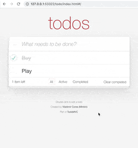
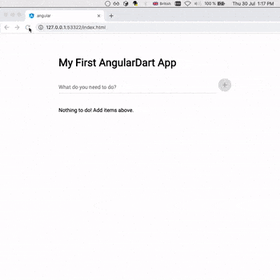
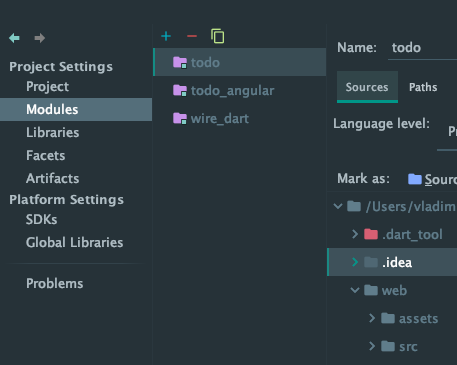
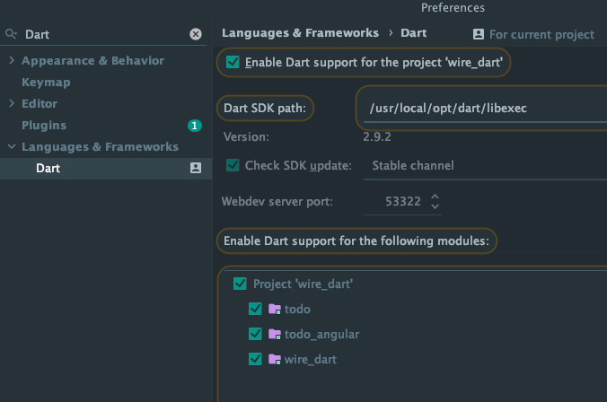

## Examples

For every project in example folder you have to run `pub get` from terminal or from IDE opened `pubspec.yaml`
###### (you might need to change the port number if you want to run multiple web apps simultaneously)

### 1. Counter (web): Simple "Increase/Decrease/Output" example of Wire use 
- Open IDEA or WebStorm
- Select build target - Dart Web, 
- Set "HTML file" to: example/counter/web/index.html
- Run Debug

### 2. Todo MVC (web): Complex Todo application based on TodoMVC CSS

- Open IDEA or WebStorm
- Select build target - Dart Web 
- Path to: example/todo/web/index.html
- Run Debug

### 3. TodoMVC with commands (web)
- Open `example/todo-commands` as a module and run `dart pub get`.
- Select build target - Dart Web, HTML file: example/todo-commands/web/index.html
- Run Debug

### 4. SPA example (web)
- Open `example/spa` as a module and run `dart pub get`.
- Select build target - Dart Web, HTML file: example/spa/web/index.html
- Run Debug (`sh run_debug.sh` is also available)

### 5. API calls variations (console): Possible variation of Wire API use
- Open IDEA
- Select build target - Dart Command Line App, point to example/api/wire_api_example.dart
- Run Debug

### 6. Todo with AngularDart web 
#### (**NO SUPPORT FOR NULL-SAFETY - DEPRECATED**)

- Import `example/_shared` and `example/todo-angular` as modules in IDEA and run `dart pub get` in both.
- The `wire_example_shared` path dependency resolves the shared code; no symlink is needed.
- Run DartWeb configuration with example/todo-angular/web/index.html

### Setup in IDEA:
To run these examples import them as a module from `File -> Project Structure` in IDEA and enable Dart SDK for each from `Preferences -> Languages & Frameworks -> Dart`

